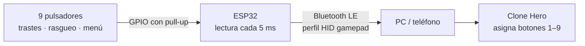
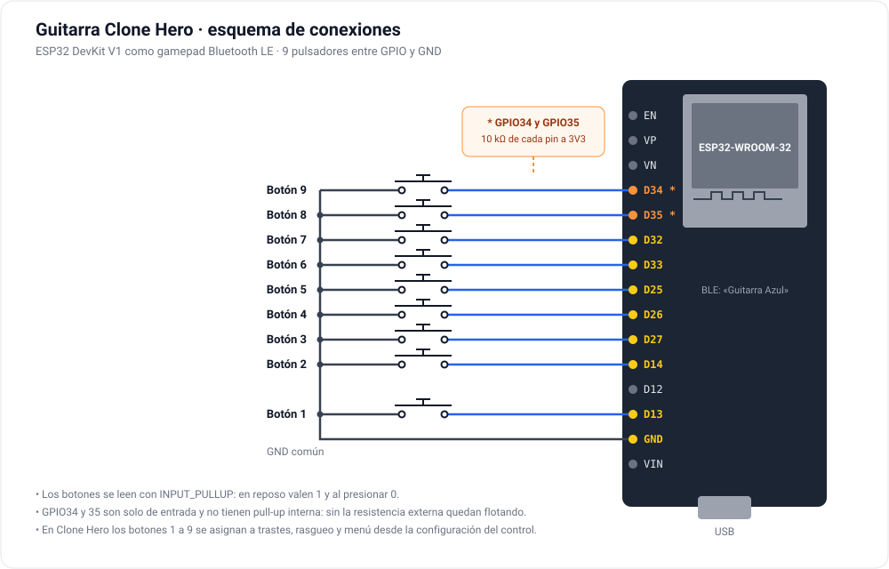

# Guitarra inalámbrica para Clone Hero (ESP32)

  
  

Control inalámbrico para jugar **Clone Hero** con una guitarra. Un ESP32 se anuncia por **Bluetooth LE**
como un gamepad estándar («Guitarra Azul») con 9 botones, así que la PC lo reconoce sin drivers y Clone Hero
lo configura como cualquier control.

## Cómo funciona

- Cada pulsador va entre su GPIO y GND. Presionado se lee 0 y suelto 1.
- El firmware envía un reporte BLE **solo cuando cambia algún botón**, para no saturar el enlace.
- En Clone Hero, en *Settings → Controls*, se asigna cada botón del gamepad a un traste, al rasgueo o al menú.

## Conexiones

| Botón del gamepad | GPIO | Nota |
|---|---|---|
| 1 | 13 | |
| 2 | 14 | |
| 3 | 27 | |
| 4 | 26 | |
| 5 | 25 | |
| 6 | 33 | |
| 7 | 32 | |
| 8 | 35 | **Pull-up externa de 10 kΩ a 3V3** |
| 9 | 34 | **Pull-up externa de 10 kΩ a 3V3** |

> GPIO34 y GPIO35 son pines solo de entrada y **no tienen resistencia pull-up interna**. Sin la resistencia
> externa quedan flotando y pueden generar pulsaciones fantasma.

**Materiales:** ESP32 DevKit V1 · 9 pulsadores · 2 resistencias de 10 kΩ · cuerpo de guitarra · batería
recargable con regulación a 5 V por USB o VIN.

## Compilar y usar

1. Arduino IDE 2 con el paquete **esp32 de Espressif** (3.x) y la placa **ESP32 Dev Module**.
2. Instale la librería **ESP32-BLE-Gamepad** (lemmingDev) desde el gestor de librerías; instala también
   *NimBLE-Arduino*.
3. Abra `ControlEsp32Guitarra/ControlEsp32Guitarra.ino` y suba el programa. Compila sin advertencias y usa el
   47 % de la flash.
4. En la PC, empareje el dispositivo Bluetooth **Guitarra Azul** y asigne los botones en Clone Hero.

## Cambios respecto de la primera versión

- Se declaraban 10 botones pero solo había 9 pines: el décimo leía el GPIO0 (BOOT) y enviaba un número de
  botón inválido. Ahora son 9.
- La detección de cambios comparaba los arreglos como punteros (siempre distintos), así que enviaba un
  reporte cada ciclo. Ahora solo se envía cuando algo cambia.
- La lectura pasó de 20 ms a 5 ms para reducir la latencia al tocar.
- El sketch se movió a su propia carpeta, como exige Arduino IDE.

Estos cambios compilan sin advertencias, pero todavía no se han probado en la guitarra física.
